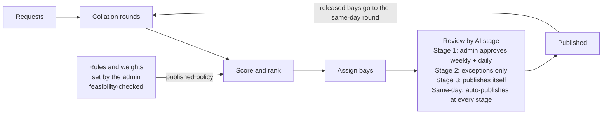

# 03 — Allocation Model

Every bay is allocated in three steps: **collate** requests, **score** them with admin-weighted rules, then **assign** bays. AI's role grows from explaining decisions to running the allocation, one gated stage at a time. All times and percentages below are **proposed defaults the admin can change per site**.



---

## 1. Request collation

Requests can be made up to **28 days ahead** but are held and allocated together in scheduled rounds. A request made on day 1 of the window is treated the same as one made on the last day.

| Round | Collects | Runs (site time) | Employee gets |
| --- | --- | --- | --- |
| **Weekly** | All requests and recurring patterns for next Mon–Fri | Friday 12:00 | Confirmed or waitlisted for each day by Friday 14:00 |
| **Daily** | New or changed requests for day D, plus everyone still waitlisted | 18:00 on the working day before D (Friday for Monday) | Final answer by 19:00 that evening |
| **Same-day** | Same-day requests, the waitlist, the held-back pool, released no-shows | Every 30 min from 07:00 | An offer with a 10-minute window to accept |

Rules:

- Working days are set per site (default Mon–Fri). Rounds only target working days. The daily round for the first working day of a week runs on the last working day before it (Friday 18:00 for Monday), after that week's weekly round has published.
- One request per employee per day. A new request for the same day replaces the old one.
- A request records: date, bay type, arrival window, optional reason category (`client_visit`, `event`, `medical_appointment`, `other`).
- Recurring patterns create requests in each weekly round. Skipping a day withdraws that request.
- **Which round decides a request** (shown to the employee, and the edit cutoff): the weekly round for that date's week if it has not run yet; otherwise the daily round on the working day before; otherwise the same-day rounds on the day, every 30 min from 07:00 until the site's same-day end time (default **17:00**). After the last same-day round, or for past days, non-working days and days beyond the horizon, the date is closed. Logic: `packages/shared/src/deciding-round.ts`.
- A request can be changed or withdrawn until its deciding round runs. Requests are validated per date and created all-or-nothing. EV and accessible eligibility are checked when the request is made (and again by the engine).
- Patterns feed the week the next weekly round will allocate: requests are created when the pattern is saved and by the `recurring-expand` job. A manual request for a day always wins over the pattern. Withdrawing a pattern's request counts as skipping that day, so the pattern never recreates it.
- **Submission time is stored for audit but never scored.** Equal scores are settled by a logged random draw.
- A **same-day pool** (default **10%** of bays) is held out of the weekly and daily rounds.
- The admin's collation view shows requests against supply by day and bay type, the oversubscription ratio and forecast demand still to come.

---

## 2. Rules and weights

Five rule types. Only **weighted factors** feed the score. The others shape eligibility and what is set aside first.

| Rule type | What it does | Example |
| --- | --- | --- |
| Eligibility | Limits who may use a bay type | Only registered EVs in charger bays |
| Reservation | Sets bays aside before scoring | Accessible bays for approved users; event-day blocks |
| Weighted factor | Adds to a request's score | Rolling fairness at 35% |
| Cap | Limits what one person can win | At most 3 peak days per employee per week |
| Tie-breaker | Settles equal scores | Seeded, logged random draw |

### Score

Each weighted factor is normalised to 0–1, and the weights total 100%:

```
score = Σ (w_i × f_i)     where Σ w_i = 100%,  0 ≤ f_i ≤ 1
```

### Starting rule catalogue

| Rule | Type | Data and source | Feasible in v1 | Default weight |
| --- | --- | --- | --- | --- |
| Accessibility or medical need | Reservation | Admin-approved flag with expiry; no health records | Yes | Reserved first |
| EV match | Eligibility | Vehicle type from profile | Yes | Eligibility only |
| Rolling fairness | Weighted | Peak days won in last 4 weeks (allocation history) | Yes | **35%** |
| Business need for the day | Weighted | Reason category on the request; admin spot-checks | Yes, but self-declared and gameable | **25%** |
| No-show history | Weighted (lowers score) | Missed check-ins | Yes, from week 3 | **15%** |
| Commute distance band | Weighted | Self-declared band (<10, 10–25, >25 km); optional | Partly; missing = neutral | **10%** |
| Client-facing role | Weighted | Role tag by admin or CSV import | Partly | **10%** |
| Seniority or tenure | Weighted | Join date via CSV; HRMS stubbed | Partly | **5%** |
| Carpool | Weighted | All riders confirm in-app | No, P2 | 0% until live |
| Booking time (FCFS) | — | — | **Removed by design** | — |

### Bay-type matching and fallback

| Request type | First choice | Fallback when no first-choice bay is left |
| --- | --- | --- |
| `car` | Car bay | None |
| `ev` | EV (charger) bay | Car bay, unless the employee ticks "EV bay only" |
| `accessible` | Accessible bay (approved users only) | Car bay |
| `two_wheeler` | Two-wheeler zone | None |
| `carpool` (P2) | Carpool bay | Car bay |

- Fallback runs after all first-choice assignments for that day, in rank order, so a fallback never takes a bay from a higher-priority first-choice request.
- Car requests never get EV or accessible bays in weekly or daily rounds. A site may turn on `evOverflowSameDay` (default **off**) to offer EV bays still free in a same-day round to car requests.
- A fallback bay counts as a win for caps and rolling fairness. The decision record notes that fallback was used.

### Feasibility checks (before a rule can be published)

1. **Data coverage**: share of active employees with the data. Below 90%, the admin must choose a neutral value for missing data or the rule cannot go live.
2. **Privacy**: the field's personal-data class under the DPDP Act. Sensitive fields need a stated purpose and consent. Health details are never stored, only an approved flag.
3. **Gaming risk**: self-declared inputs are flagged, and the admin sets a spot-check rate.
4. **Impact simulation** (P1): replay the last 4 weeks of requests with the new weights. Show winners, the fairness spread and each segment's share (EV, two-wheeler, new joiners).

As built (M2), publishing is **blocked** when an enabled rule with weight > 0 has coverage below 90% and no neutral value, uses data not collected yet (carpool, P2), is easy to game (business need) without a spot-check rate, or uses sensitive data without a stated purpose. Lower coverage with a neutral value, and self-declared inputs, show as warnings. Coverage is measured over active employees of the site. Each rule's data source, privacy class and gaming risk live in `packages/shared/src/rules.ts`.

**Versions:** one policy per site. A draft copies the latest version; only one draft at a time. Publishing needs a reason, locks the version and sets `effective_from_week` to the target week of the next weekly round still to run. If two versions are published for the same week, the higher version number wins. Stored rules are validated strictly when written and loosely when read, so rules saved under an older schema still load and show their problems.

### Guardrails

- Weights must total 100%.
- No single factor may exceed 50% (configurable).
- Each policy is versioned with an **effective week** (the Monday of the first week it applies to) and takes effect from the **next weekly round** to run, never mid-round. Daily and same-day rounds use the version in force for their target date's week.
- Employees always see the current policy in plain language.

---

## 3. Engine processing order (implementation contract)

`packages/engine` exposes one pure function (full types in `packages/engine/src/types.ts`):

```ts
allocate(input: {
  round: { type; dates };            // weekly: several dates; daily/same-day: one
  requests: EngineRequest[];         // NO submission time: it is not an input at all
  bays: EngineBay[];                 // active bays, with a stable `code`
  unavailable: { bayId; date }[];    // event blocks + bays already held by bookings
  people: EnginePerson[];            // EV flag, accessible approval end date, optional profile fields
  history: EngineHistory[];          // peak wins (lookback + this week), bookings, no-shows
  policy: EnginePolicy;              // rules, factor cap, pool %, EV overflow, weeks of data
  seed: string;
}): {
  assignments: Assignment[];         // requestId → bayId (+ fallbackUsed)
  waitlist: WaitlistEntry[];         // position per (date, bay type); capped entries last
  decisions: Decision[];             // one per request: outcome, reasonCode, score, rank, breakdown
  dayOrder: string[];                // order the days were allocated in
  heldBack: { date; bayIds }[];      // same-day pool bays (weekly/daily only)
}
```

Implementation details fixed by the engine (and its tests):

- **Outcomes:** `confirmed`, `waitlisted`, or `ineligible` (failed an eligibility rule: `not_ev`, `accessible_not_approved`). Ineligible requests are not scored. Each decision carries a `reasonCode` for the plain-language reason (FR-15).
- **Tie-break:** each request's draw depends only on `(seed, date, requestId)` (FNV-1a hash → `pure-rand` xoroshiro128+), so results never depend on input order and a logged seed replays a round exactly. Scores are compared at 1e-9 so float noise never breaks a real tie.
- **Same-day pool:** in weekly and daily rounds, `floor(pool% × bays of that type)` **car** and **EV** bays are held back per date, taken from the free bays with the highest codes. Accessible bays are never pooled; they stay reserved.
- **Accessible bays** go only to requests whose approval is valid on the date. Unused accessible bays stay empty in every round.
- **Capped requests** get no bay in weekly or daily rounds. In same-day rounds they may take leftovers after every uncapped request.
- **Same-day EV overflow** (when on) runs after fallback: unassigned car requests may take free EV bays (`allocated_overflow`).
- The engine rejects invalid input: policy guardrail errors (`POLICY_*`), two requests from one employee for one date, or a request outside the round's dates.

Order of operations:

1. Drop requests that fail **eligibility** rules.
2. Apply **reservations** (accessibility approvals, event blocks, same-day pool hold-back).
3. Compute each **weighted factor** (0–1, neutral value when data is missing) and the total score.
4. Sort by score descending. Break ties with a PRNG seeded by `seed` (logged).
5. Assign bays in rank order, respecting **caps** and bay-type matching (first choice, then fallback; see *Bay-type matching and fallback*). Stop when the bays run out. Never assign beyond supply.
6. Everyone else goes to the waitlist in rank order.
7. Emit a decision record per request with the full factor breakdown.

### Multi-day rounds (weekly)

A weekly round covers several days and caps span the week, so the order in which days are allocated changes who wins. To keep it fair and deterministic:

1. Compute each day's oversubscription ratio (active requests ÷ allocatable bays, all bay types).
2. Allocate days one at a time, **most oversubscribed first** (ties: earlier date first). Steps 1–7 run for each day.
3. After each day, each employee's wins in this round are added to their cap count and rolling-fairness history before the next day is scored.
4. A request that loses only because its owner hit a cap is waitlisted **behind every uncapped request** with reason `cap_reached`. It is promoted only if no uncapped request is waiting.

Caps therefore bind on the most contested (peak) days, not on whichever day comes first in the week. Daily and same-day rounds cover one day, so this step does not apply.

Invariants (covered by property tests):

- `confirmed(bayType, date) ≤ bays(bayType, date)`
- Same input + seed → identical output.
- Changing only submission timestamps never changes the output.
- Shuffling the order of any input list never changes the output.
- Weights total 100% and no factor exceeds the cap.
- No employee wins more days than a cap allows in a round (a capped request is only promoted later when no uncapped request is waiting).
- A fallback assignment never displaces a first-choice request for that bay type.

---

## 4. AI autonomy stages

The end state is AI running allocation on its own within the published weights. **The pilot starts at Stage 1.**

| Stage | AI does | Admin does | Moves on when |
| --- | --- | --- | --- |
| **1. Explain** (pilot launch) | Rules engine scores and assigns. AI writes each decision's reason and flags anomalies (no-show patterns, odd reason claims, low data coverage) | Approves every weekly and daily round before it publishes; audits same-day rounds | Admin opts in after ≥ 2 weeks of runs |
| **2. Recommend** | Proposes full allocation incl. best-fit bay by zone/type and waitlist promotions. Suggests weight changes with simulated impact | Reviews exceptions only, approves each round, accepts or rejects suggested weights | Overrides < 2% for 4 straight weeks, disputes −50%, fairness spread met, admin opts in |
| **3. Run** | Runs and publishes every round automatically. Same-day rounds run without review | Audits, handles appeals, can pause AI in one click (returns the site to Stage 2) | End state |

### Review and publish timing

| Round | Stage 1 | Stage 2 | Stage 3 |
| --- | --- | --- | --- |
| Weekly | Admin approves | Admin reviews flagged exceptions, then approves | Publishes automatically |
| Daily | Admin approves | Admin reviews flagged exceptions, then approves | Publishes automatically |
| Same-day | **Publishes automatically**; admin audits and can override | Same | Same |

Same-day rounds publish without review at every stage: they run every 30 minutes and offers expire in 10, so waiting for approval would leave bays empty. They only hand out the same-day pool, released no-shows and cancellations under the published policy, and every decision is logged and can be overridden.

Approval deadlines (site settings): weekly **Friday 14:00**, daily **19:00**. While a weekly or daily round is pending:

- The admin gets a reminder 60 minutes after the round runs and again 15 minutes before the deadline. A site may name **backup admins** who can also approve.
- After the deadline, affected employees see "Results delayed: awaiting admin review". Nothing publishes without approval.
- Rounds for the same date publish in order: a daily round for day D waits until the weekly round covering D has published.
- **Day-start safety valve:** if any weekly or daily round covering day D is still unapproved at the first same-day round of D (07:00), it publishes automatically, the admin is told, and the audit log records `publish_mode = auto_timeout`. Sites can turn this off (`autoPublishAtDayStart`, default **on**).

Rules at every stage:

- AI never changes rules or weights itself. It can only suggest.
- Scoring is deterministic and replayable.
- Every decision is logged with its score breakdown, and the admin can override any of them.
