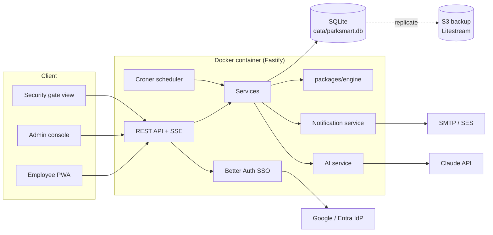

# 07 — Architecture

## System view



## Repo layout

```
parksmart/
├─ apps/
│  ├─ web/                 # React + Vite PWA
│  │  └─ src/
│  │     ├─ routes/        # app/ (employee), admin/, gate/
│  │     ├─ components/    # shadcn/ui + feature components
│  │     ├─ features/      # booking, policy, review, analytics…
│  │     └─ lib/           # api client, query hooks, i18n
│  └─ api/                 # Fastify server
│     └─ src/
│        ├─ routes/        # thin HTTP handlers, one folder per resource
│        ├─ services/      # business logic (rounds, bookings, policy…)
│        ├─ jobs/          # croner scheduler, idempotent runOnce (job_runs), job functions
│        ├─ ai/            # Claude prompts, clients, fallbacks
│        ├─ notifications/
│        ├─ auth/          # Better Auth config, dev-only login plugin
│        ├─ config/        # env parsing and startup guards
│        ├─ lib/           # AppError and helpers
│        └─ plugins/       # auth mount + role guard, security, errors, openapi, web-static
├─ packages/
│  ├─ engine/              # pure allocation engine + property tests
│  ├─ db/                  # Drizzle schema, migrations, seed, db client
│  └─ shared/              # Zod schemas, types, constants (bay types, roles)
├─ data/                   # parksmart.db (gitignored)
├─ docs/                   # this folder
├─ .claude/commands/       # custom Claude Code commands
├─ .cursor/rules/          # Cursor rules (point to CLAUDE.md)
├─ CLAUDE.md
├─ docker/                 # Dockerfile, Caddyfile, litestream.yml
└─ .env.example
```

## Layering rules

- **routes → services → (engine | db | ai | notifications)**. Routes never touch the DB directly.
- `packages/engine` imports nothing except `packages/shared` types.
- `packages/shared` imports nothing from other packages.
- The web app talks to the API only, through the typed client in `apps/web/src/lib/api`.
- These rules are enforced by ESLint (`no-restricted-imports` etc. in `eslint.config.js`): the engine cannot import I/O modules or use `Math.random`/`Date.now`/`new Date()`, and `apps/api/src/routes` cannot import `@parksmart/db` or `drizzle-orm`.
- Every route declares its roles with the `requireRole(...)` preHandler, which sets `request.actor` (id, org, site, role). Services take the actor's site for scoping.
- Every audit entry goes through `services/audit.ts` (`writeAudit`), inside the same transaction as the change.

## Round lifecycle (Stage 1)

1. Scheduler fires `weekly-round` → inserts a `job_runs` row (unique key `weekly:<site>:<week>`). If it already exists, stop.
2. `RoundService` loads requests, bays, active policy and history → calls `engine.allocate()` with a fresh seed.
3. Result saved as a `round` in status `pending_review` with all `allocations` and decision breakdowns (one transaction).
4. AI service writes plain-language reasons (template fallback on failure).
5. Admin (or a backup admin) reviews → approves or overrides (reason required) → status `published`, `publish_mode = admin`. The `round-deadlines` job sends reminders and, at 07:00 on the target day, auto-publishes anything still pending (`auto_timeout`).
6. Bookings created/confirmed, waitlist written, notifications queued, audit entries written.

At Stage 3, step 5 is skipped. At Stage 2, only flagged exceptions need review. Same-day rounds skip step 5 at every stage (`publish_mode = auto_same_day`); see `03-allocation-model.md` §4.

## Booking-release path

Cancel or auto-release → booking `cancelled` / `auto_released` → bay added to the same-day pool → next `same-day-round` offers it to the waitlist → offer expires in 10 min → next person.

## Concurrency with SQLite

- One app instance only. All writes go through the single `better-sqlite3` connection.
- Rounds use `BEGIN IMMEDIATE` so nothing else writes mid-allocation.
- Jobs are idempotent via `job_runs` unique keys, so a restart never double-runs a round.
