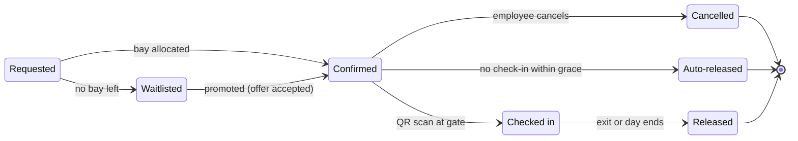

# 10 — UX and Key Flows

## Booking lifecycle

The only way a confirmed bay leaves its owner is a **cancel** or a **missed check-in**. (Keeps the Base44 status flow and adds auto-release.)

`Cancelled`, `AutoReleased` and `Released` are end states for that booking. A cancelled or auto-released booking frees its **bay**, which goes to the same-day pool and is offered to the next waitlisted request; the released booking itself does not change again.

## Key flows

1. **Planned request (Divya).** Open app → pick days or type "car bay Tue–Thu next week" → confirm → status *Requested* → weekly round on Friday → *Confirmed* or *Waitlisted* with a reason → reminder the evening before → QR scan at the gate.
2. **Last-minute day (Divya).** Request today → joins the next same-day round (every 30 min) with the held-back pool and released no-shows → offer to accept within 10 min, or waitlisted with live position and a reason.
3. **Set up rules (Meera).** Open Policy → start from the catalogue → add or edit a rule and its weight → builder shows coverage, privacy class, gaming risk and simulated impact → publish a new policy version from next week's round.
4. **Allocation round (Meera).** Round closes → engine scores requests → Stage 1: Meera (or a backup admin) approves or overrides weekly and daily rounds with a reason, while same-day rounds publish automatically for her to audit; Stage 2: reviews only AI-flagged exceptions; Stage 3: round publishes itself and she audits → employees notified.
5. **Event day (Meera).** Forecast flags a surge → Meera blocks bays and raises the same-day pool → employees see blocked bays and the reason.
6. **Reporting (Meera).** Weekly AI summary in plain English → monthly export of occupancy, no-shows, fairness spread, disputes and override rate.
7. **Gate check-in (Security).** Scan employee's daily QR → booking marked *Checked in* → or search name/bay and check in manually.

## Key screens

| Screen | Route | User | Must show |
| --- | --- | --- | --- |
| Home | `/app` | Employee | Next booking and status, one-tap book, today's QR code |
| Book | `/app/book` | Employee | Calendar, bay type, recurring toggle, chat box for NL booking, which round decides it |
| Booking detail | `/app/bookings/:id` | Employee | Status, bay and zone, reason, cancel, running late, appeal |
| Policy (read-only) | `/app/policy` | Employee | Current rules and weights in plain language |
| Profile | `/app/profile` | Employee | Vehicles, optional fields with why-we-ask, consent, data export/delete |
| Allocation review | `/admin/rounds/:id` | Admin | Proposed allocations, flags, approve all, override with reason |
| Collation | `/admin/collation` | Admin | Requests vs supply, oversubscription, forecast |
| Policy | `/admin/policy` | Admin | Version list with status (draft, scheduled, in force, superseded); rule builder with live weight total, per-rule settings (neutral value, spot-check, cap, stated purpose) and inline feasibility; publish with a required reason and the week it takes effect; plain-language preview. Impact simulation (P1) and AI stage (M5+) to come. Round times and grace window are under Site setup → Settings |
| Site setup | `/admin/site` | Admin | Tabs: zones & bays (bulk add, deactivate), blocks (bays or a whole zone, with a reason), accessible approvals (flag + end date only), settings (rounds, deadlines, pool, grace, backup admins). User import is P1 |
| Analytics | `/admin/analytics` | Admin | Utilisation, no-shows, fairness spread, forecast, export |
| Audit | `/admin/audit` | Admin | Filterable log, export |
| Gate view | `/gate` | Security | Today's bookings by bay, QR scanner, manual check-in, bay map |

## UX principles

- **Under 30 seconds and 3 taps** for a single-day booking on mobile.
- **Always show the reason** for a decision, in under 40 words.
- **Show which round decides** a request and when the answer comes.
- **Explain why optional data is asked for**, and make "skip" obvious.
- **Accessible by default:** WCAG 2.1 AA; screen-reader-friendly accessible-bay flow.
- Respect the notification cap (3/day) and quiet hours (22:00–07:00). Waitlist offers, release warnings and check-in reminders are exempt.
- **Never leave the employee guessing.** If a round is still awaiting admin review after its deadline, show "Results delayed: awaiting admin review".
- If a request got a fallback bay (for example, an EV request given a car bay), say so in the reason.
